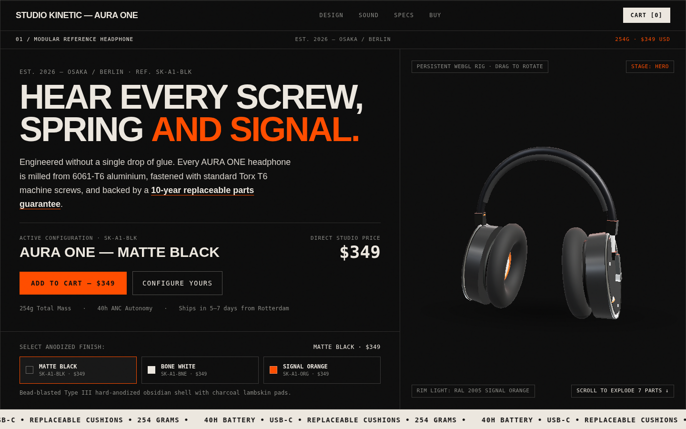
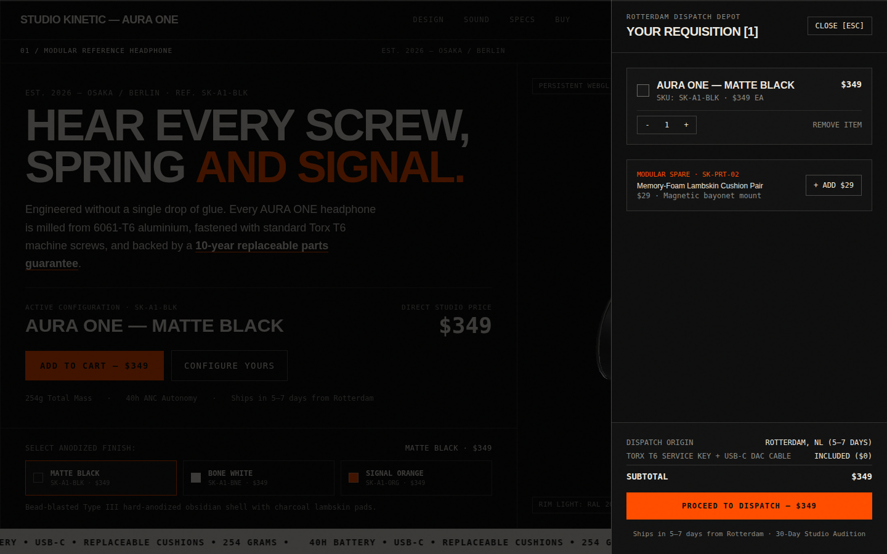
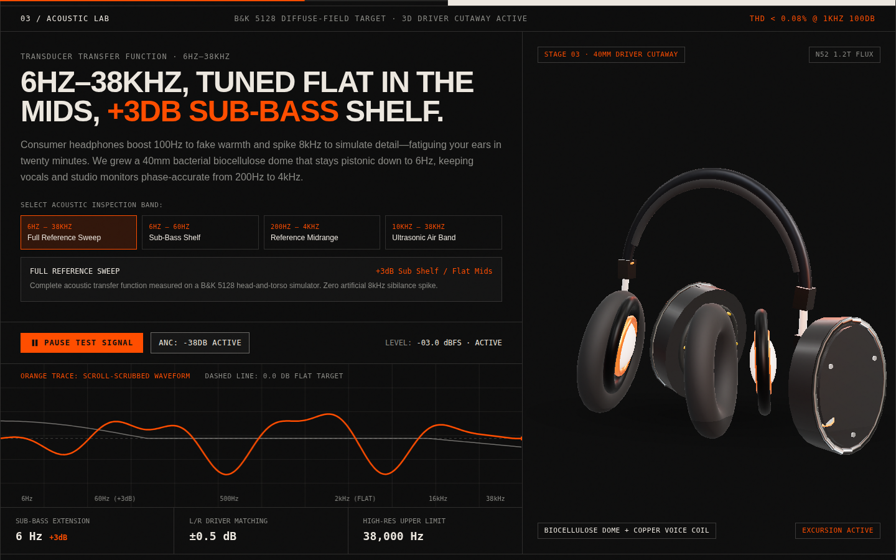
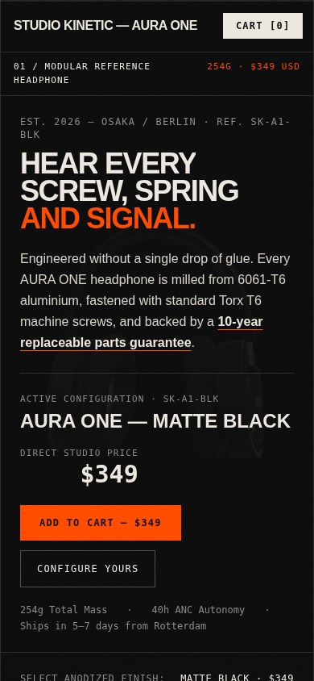

# AURA ONE — Studio Kinetic

An interactive 3D product launch website for **AURA ONE**, a premium wireless reference headphone by Studio Kinetic. Built as a concept project to demonstrate the standard of a modern product-launch site: real-time 3D, scroll-driven storytelling, and a working shopping experience — the same level of site a product brand would launch with.



## Highlights

- **Real-time 3D product hero** — a fully procedural 3D headphone (Three.js / WebGL) the visitor can rotate and explore, with colorway switching across three finishes: Matte Black, Bone White, and Signal Orange
- **Working cart** — add finishes, adjust quantities, slide-out cart drawer with totals
- **Sound section** — interactive waveform player built on the Web Audio API
- **Scroll-driven storytelling** — GSAP ScrollTrigger animations, smooth scrolling (Lenis), custom cursor and loader
- **Responsive by design** — fully usable on mobile with zero horizontal overflow





## The product (concept)

| | |
|---|---|
| Price | $349 |
| Weight | 254 g |
| Bluetooth | 5.4 — LDAC / AAC / SBC |
| Battery | 40 h with ANC — 10 min charge = 5 h playback |
| Driver | 40 mm biocellulose |

## Tech stack

React 19 · TypeScript · Vite · Three.js · GSAP ScrollTrigger · Tailwind CSS · Web Audio API

## Run locally

```bash
npm install
npm run dev
```

## What I can build for your business

This site is a working sample of what I deliver:

- **Product launch & brand websites** — a launch page that makes a product feel premium
- **Interactive 3D product showcases** — customers rotate and explore your product before they buy
- **Online store front-ends** — product pages with a smooth, working cart experience
- **Business websites** — services, gallery, contact and WhatsApp buttons, Google Maps
- **Landing pages** — fast-loading pages built to turn visitors into enquiries
- **Mobile-first, always** — every site tested on desktop and phone before delivery

Have a product or business that needs a site like this? Get in touch — I build it, test it, and hand it over working.

## About

Concept project — fictional brand, created to demonstrate a premium product-launch website for a business. Designed, directed, and verified end-to-end by Awais Ahmed Shah.
